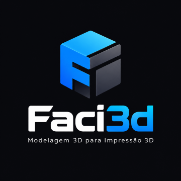
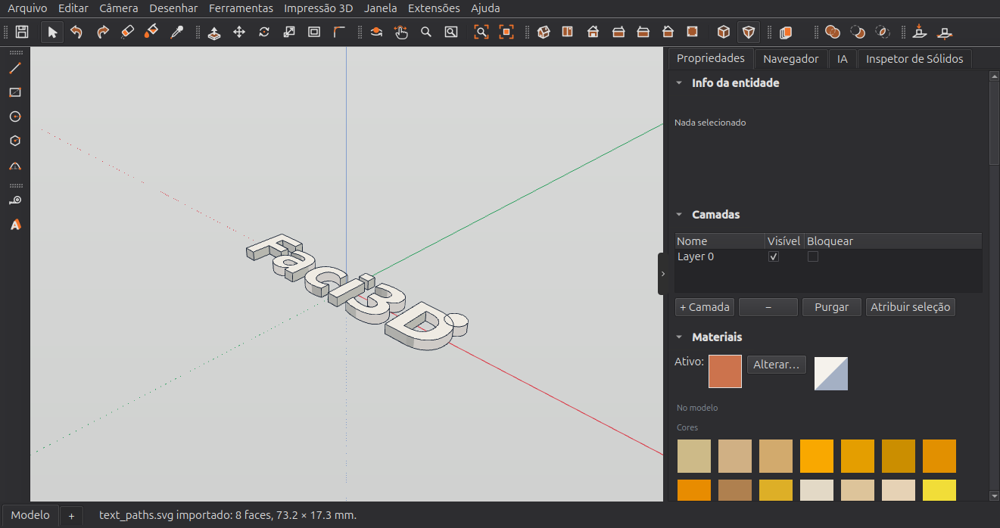

<p align="center">
  
</p>

# Faci3D

**Modelagem 3D para impressão 3D — simples, livre e feita para quem quer
desenhar uma peça e mandar para a impressora.**


O Faci3D usa o jeito de modelar mais fácil que existe: desenhar uma forma no
chão e **empurrá-la** para ganhar volume (*push/pull*). Ele é um fork do
[IngeTrazo](https://github.com/ingelibre/ingetrazo), um modelador livre no
estilo do SketchUp. Mantém as ferramentas de modelagem do original e deixa
de lado tudo o que é de arquitetura e engenharia civil (georreferência, BIM,
pranchas, cortes, sombras), para que a tela mostre só o que importa para
imprimir.



## Status

**Versão 0.1.0 — em desenvolvimento, ainda sem pacote para instalar.** O
motor de modelagem vem do IngeTrazo 0.5.8, que já é usado em trabalho real e tem cerca de 4.500
testes automatizados. O que é próprio do Faci3D (modo impressão 3D, mesa de
impressão, importação de SVG, identidade) é recente: por enquanto, execute a
partir do código-fonte (veja [Como executar](#como-executar)).

## O que já funciona

**Modo impressão 3D** — a interface abre enxuta:

- barras com as ferramentas do dia a dia: Selecionar, Linha, Retângulo,
  Círculo, Polígono, Arco, **Empurrar / Puxar**, Mover, Girar, Escalar,
  Deslocar (offset), Chanfro 3D, Fita Métrica, Texto 3D e as operações
  booleanas (união, subtração, interseção);
- as demais ferramentas (Seguir, Inverter, Transferidor, cotas…) continuam
  nos menus, com seus atalhos;
- os recursos de arquitetura ficam escondidos, não apagados — veja
  [Interface completa](#interface-completa);
- documentos novos em **milímetros** (precisão de 0,1 mm), sem perguntar;
- um **vaso de planta de 150 mm** ao lado da origem dá a noção de escala.

**Mesa de impressão (opcional)** — menu **Impressão 3D**:

- **Impressora…**: escolha entre modelos comuns (Ender 3, Prusa MK4/MINI,
  Bambu Lab A1/A1 mini/P1S, Anycubic Kobra 2, Elegoo Neptune 4…), digite as
  medidas, ou escolha *Nenhuma* e modele livremente;
- com impressora definida, o viewport mostra a placa com grade de 10 mm e o
  volume de impressão;
- **Colocar na mesa** (Ctrl+Shift+B) e **Centralizar na mesa** apoiam a
  seleção — ou o modelo todo — no chão; com impressora, avisam quando a peça
  não cabe.

**Importar SVG** — *Arquivo ▸ Importar ▸ Desenho SVG*:

- um logo, um nome ou um contorno chegam como **faces planas no chão**,
  prontas para o Empurrar / Puxar;
- formas fechadas viram faces; um contorno dentro de outro vira furo (o miolo
  do "O"), e uma ilha dentro do furo volta a ser face;
- tamanho real (lê as unidades e o `viewBox` do SVG), ajustável no diálogo
  com a proporção mantida;
- curvas precisas (erro máximo de 0,05 mm) e laterais lisas depois da
  extrusão;
- texto precisa ser convertido em curvas antes (no Inkscape: *Caminho ▸
  Objeto para caminho*).

**Herdado do IngeTrazo e útil para impressão:**

- **Empurrar / Puxar hermético**: o motor recusa uma operação que deixaria um
  sólido aberto — o arquivo que chega ao fatiador é fechado;
- **Ferramentas sólidas** (união, subtração, interseção, aparar, dividir,
  casca externa) com o [manifold3d](https://github.com/elalish/manifold), o
  mesmo núcleo do OpenSCAD e do Blender;
- **Inspetor de Sólidos**: mostra onde está o furo numa malha aberta e
  repara o que tem solução única;
- **Texto 3D** com qualquer fonte instalada;
- inferência e *snap*, medidas digitadas, guias, grupos e componentes,
  desfazer/refazer de cada operação;
- **exportar STL** (pergunta a unidade; milímetros por padrão), OBJ, glTF e
  COLLADA; **importar** STL, OBJ, glTF, COLLADA e arquivos `.skp`.

**Pintura com cores sólidas** — o painel Materiais traz só cores (a paleta
RAL completa e cores próprias). Modelos importados com textura chegam
pintados com a cor média de cada imagem.

A interface está em português do Brasil, espanhol, inglês e em mais seis
idiomas (as traduções do que é novo no Faci3D existem, por enquanto, em
português e espanhol).

## Próximos passos

1. **Pronto para imprimir?** — um painel que verifica se a peça é um sólido
   fechado, se as faces estão orientadas, se está apoiada na mesa, se cabe no
   volume de impressão e se há formas que só se tocam (não-manifold).
2. **Exportação** — 3MF, *Abrir no fatiador* (PrusaSlicer, Cura, Orca) e
   estimativa de filamento (volume, peso e comprimento).
3. **Limpeza** — remover de vez o código de arquitetura que hoje só está
   escondido, e trocar os nomes internos que ainda são do IngeTrazo
   (pacotes, extensão `.igz`, identificador do Flatpak).

## Como executar

Requer **Python 3.11 ou mais novo** e **git** (uma dependência é baixada do
GitHub).

```bash
git clone <url-deste-repositório> Faci3D
cd Faci3D
python3 -m venv ~/.venvs/faci3d
source ~/.venvs/faci3d/bin/activate      # Windows: %USERPROFILE%\.venvs\faci3d\Scripts\activate
pip install -r requirements.txt
python main.py
```

- `python main.py --check` confere a instalação e lista o que falta.
- Se o Faci3D já estiver aberto, `python main.py` só traz a janela aberta para
  a frente; para outra janela, use `python main.py --new-window`.
- No Linux, se o projeto estiver num disco NTFS, crie o ambiente virtual na
  sua pasta pessoal (como acima), não dentro do projeto.

### Interface completa

Para voltar à interface completa do IngeTrazo (georreferência, BIM, pranchas,
cortes, sombras…), feche o Faci3D e acrescente ao arquivo de configurações —
`~/.config/Faci3D/Faci3D.conf` no Linux — a linha `full_interface=1` na
seção `[ui]`. Apague a linha para voltar ao modo impressão 3D.

### Testes

```bash
pip install pytest-xdist
QT_QPA_PLATFORM=offscreen python -m pytest -q -m "not slow" -n 4
```

## Onde fica cada coisa

| Pasta / arquivo | O quê |
|---|---|
| `main.py` | ponto de entrada |
| `core/` | motor: malha, cena, desfazer, sólidos, unidades, impressora (`printer.py`) |
| `tools/` | ferramentas de modelagem (linha, retângulo, empurrar/puxar…) |
| `views/` | interface Qt; `print_mode.py` (modo impressão 3D), `print_bed.py` (mesa), `svg_import.py` |
| `formats/` | importação e exportação; `svg_in.py` (SVG), `stl.py` (STL) |
| `i18n/` | traduções, um JSON por idioma |
| `resources/branding/` | o logo do Faci3D; os ícones saem dele com `scripts/gen_faci3d_icon.py` |
| `tests/` | testes automatizados (pytest) |

O código, os comentários e as mensagens de commit seguem em **inglês**, como
no IngeTrazo, para facilitar trazer correções do projeto original.

## Créditos

O Faci3D existe porque o **IngeTrazo** existe. Todo o motor de modelagem, as
ferramentas e a maior parte da interface são obra de **Marco Sumari
Tellez** (engenheiro civil, Arequipa, Peru) e dos colaboradores do
IngeTrazo — entre eles Pedro Caeiro, Rafael García Rodríguez, Ahsan Mehmood
(autor do [OpenSKP](https://github.com/iamahsanmehmood/openskp), o leitor de
`.skp`), dafrobozao (tradução para o português do Brasil), Félix Riestra,
liuandy, deedend e outros. A lista completa está em [AUTHORS](AUTHORS) e na
janela *Ajuda ▸ Sobre o Faci3D*.

Projeto original: <https://github.com/ingelibre/ingetrazo>

## Licença

[GPL-3.0-or-later](LICENSE), a mesma do IngeTrazo. Você pode usar, estudar,
modificar e redistribuir o Faci3D, desde que os trabalhos derivados continuem
sob a mesma licença e mantenham os créditos.

---

## In English

**Faci3D** is a free 3D modeller for **3D printing**, a fork of
[IngeTrazo](https://github.com/ingelibre/ingetrazo) (a push/pull modeller in
the SketchUp tradition). It keeps IngeTrazo's modelling engine and tools and
hides the architecture features, adding a 3D-printing interface (millimetres
by default), an optional print bed with *Place on bed* / *Center on bed*,
solid-colour painting, and **SVG import** as flat faces ready for push/pull.
Early development, no release yet — run it from source
(`pip install -r requirements.txt && python main.py`). Licensed
GPL-3.0-or-later; all credit for the engine goes to Marco Sumari Tellez and
the IngeTrazo contributors.
